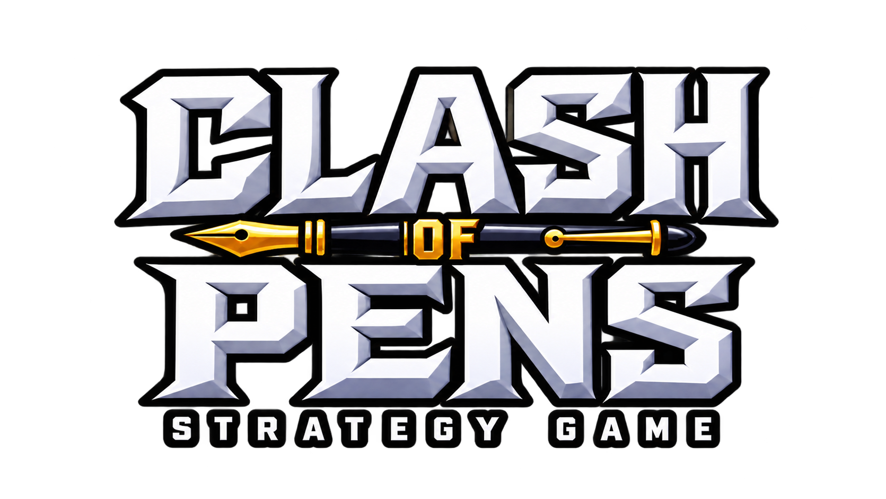

<div align="center">
  

  # Clash of Pens - The Definitive Technical Manual and Player Guide

  [](https://www.python.org/)
  [](https://pyga.me/)
  [](http://www.pymunk.org/)
  []()
  [](https://github.com/SaKin32/Clash_of_pens/actions)
</div>

---

## Table of Contents

- [1. Executive Summary and Philosophy](#1-executive-summary-and-philosophy)
- [2. Core Physics and Simulation Mechanics](#2-core-physics-and-simulation-mechanics)
  - [2.1 Physics World Architecture](#21-physics-world-architecture)
  - [2.2 Friction, Damping, and Angular Deceleration](#22-friction-damping-and-angular-deceleration)
  - [2.3 Aiming, Impulse, and Non-Linear Power Curves](#23-aiming-impulse-and-non-linear-power-curves)
  - [2.4 Table Boundary, Edge Wobble, and Falling Physics](#24-table-boundary-edge-wobble-and-falling-physics)
  - [2.5 Dynamic Arena Shrink and Sudden Death](#25-dynamic-arena-shrink-and-sudden-death)
- [3. Pen Encyclopedia and Attribute Metrics](#3-pen-encyclopedia-and-attribute-metrics)
  - [3.1 Complete Attribute Matrix](#31-complete-attribute-matrix)
  - [3.2 In-Depth Pen Profiles and Strategic Playstyles](#32-in-depth-pen-profiles-and-strategic-playstyles)
- [4. Game Modes and Match Regulations](#4-game-modes-and-match-regulations)
  - [4.1 Player vs Computer (PvC) and AI Architecture](#41-player-vs-computer-pvc-and-ai-architecture)
  - [4.2 Player vs Player (PvP) - Single Match (1v1)](#42-player-vs-player-pvp---single-match-1v1)
  - [4.3 Player vs Player (PvP) - Team Match (2v2 and 3v3)](#43-player-vs-player-pvp---team-match-2v2-and-3v3)
  - [4.4 Match Lifecycle, Scoring, and Resolution](#44-match-lifecycle-scoring-and-resolution)
- [5. System Requirements and Prerequisites](#5-system-requirements-and-prerequisites)
- [6. Complete Cross-Platform Installation Guide](#6-complete-cross-platform-installation-guide)
  - [6.1 Microsoft Windows Setup Guide](#61-microsoft-windows-setup-guide)
  - [6.2 Linux Setup Guide (Ubuntu, Debian, Fedora, Arch)](#62-linux-setup-guide-ubuntu-debian-fedora-arch)
  - [6.3 Apple macOS Setup Guide (Apple Silicon and Intel)](#63-apple-macos-setup-guide-apple-silicon-and-intel)
- [7. Configuration, Persistence, and Storage Architecture](#7-configuration-persistence-and-storage-architecture)
- [8. Headless Simulation and Automated Test Suite](#8-headless-simulation-and-automated-test-suite)
- [9. Production Packaging and Executable Compilation](#9-production-packaging-and-executable-compilation)
- [10. Comprehensive Troubleshooting and Diagnostics](#10-comprehensive-troubleshooting-and-diagnostics)
- [11. Complete Codebase Anatomy and File Manifest](#11-complete-codebase-anatomy-and-file-manifest)
- [12. Author Information and Academic Credits](#12-author-information-and-academic-credits)

---

## 1. Executive Summary and Philosophy

Clash of Pens is an engineering-grade 2D desktop game designed to digitize and elevate the nostalgic South Asian schoolroom tradition known universally as "Pen Fight". In physical classrooms, students placed writing pens on wooden desks and flicked them with their fingers, attempting to collide with rival pens and knock them over the table boundary while avoiding self-elimination.

While outwardly accessible and casual, the game translates intricate Newtonian mechanics into deterministic, real-time code. Rather than employing arbitrary arcade physics or scripted collision animations, Clash of Pens runs on a dedicated continuous rigid-body simulation built on the Pymunk engine (a Python wrapper for the Chipmunk2D physics library), alongside the high-performance SDL2-backed rendering pipeline of Pygame Community Edition (pygame-ce).

Key design principles governing the software include:
- **Physical Authenticity:** Collisions faithfully account for momentum transfer, rotational inertia, friction gradients, and center-of-mass imbalances.
- **Strategic Depth:** Pens are not cosmetic skins; each pen possesses distinct geometry, mass distribution, surface friction, and launch elasticity that demand distinct tactical playstyles.
- **Deterministic Heuristic AI:** The computer opponent does not cheat with artificial advantages. Instead, it runs internal headless physics simulations to project future outcomes, mimicking human forward-thinking.
- **Defensive Robustness:** The persistence layer implements atomic disk writes, headless execution interfaces for continuous integration, and defensive fallback defaults that eliminate unhandled exceptions.

---

## 2. Core Physics and Simulation Mechanics

### 2.1 Physics World Architecture
The simulation environment operates within a top-down planar coordinate system managed by the `PenWorld` class (`game/physics.py`). Because the playing field represents a horizontal wooden desk viewed from above, gravity in the coordinate space is explicitly set to zero:

$$\vec{g} = (0, 0)$$

Movement across the desk is governed solely by linear impulses imparted by player flicks, collision reactions between pen bodies, and resistive surface damping. 

To eliminate physical tunneling (where high-speed rotating objects pass through each other between simulation frames), the simulation advances using fixed sub-stepping:
- Fixed frame delta time: clamped to a maximum of $1/30$ seconds to mitigate frame-rate drop spikes.
- Sub-step frequency: 8 discrete integration steps per render frame (`PHYSICS_SUBSTEPS = 8`).
- Inertia computation: calculated using Chipmunk's rectangular box moment formula:

$$I = \frac{1}{12} \cdot m \cdot (l^2 + w^2)$$

where $m$ is the pen's mass, $l$ is its length in pixels, and $w$ is its width in pixels.

### 2.2 Friction, Damping, and Angular Deceleration
Replicating the tactile sensation of a pen sliding and spinning across a wooden desk required decoupling translational drag from rotational spin decay.

1. **Translational Damping:**  
   The global space damping constant (`PHYSICS_DAMPING = 0.00002`) represents the fraction of velocity retained after one full second of sliding. This guarantees that pens rapidly bleed linear speed, coming to a natural stop rather than gliding endlessly across the table.

2. **Angular Damping and Spin Boost:**  
   In naive physics simulations, high linear damping abruptly stops rotational spin, making off-center hits look stiff and unnatural. To solve this, `PenWorld` applies an analytical compensation factor after every sub-step:

   $$\text{spin\_boost} = \left(\frac{\text{ANGULAR\_DAMPING}}{\text{PHYSICS\_DAMPING}}\right)^h$$

   where $h = \frac{\Delta t}{\text{PHYSICS\_SUBSTEPS}}$, and `ANGULAR_DAMPING = 0.7`.

3. **Linear Spin Friction:**  
   To prevent infinite microscopic spinning, `SPIN_FRICTION = 15.0 \text{ rad/s}^2` continuously deducts a fixed rate of angular momentum. Once the absolute angular speed drops below the step decrement, rotation terminates instantly.

4. **Settling Thresholds:**  
   A turn is deemed complete once all pens on the desk fall below both settling thresholds:
   - Linear speed $< 8.0\text{ px/s}$ (`SETTLE_SPEED`)
   - Angular spin $< 0.4\text{ rad/s}$ (`SETTLE_ANGULAR_SPEED`)

### 2.3 Aiming, Impulse, and Non-Linear Power Curves
When a player clicks and drags on a pen, the launch engine registers the displacement vector between the initial touch origin and the release cursor position.

- **Grab Tolerance:** An extra margin of 28 pixels (`GRAB_MARGIN`) surrounds each pen hitbox, ensuring mouse interactions easily register at the narrow tips.
- **Deadzone and Saturation:** Pull distances under 15 pixels (`MIN_PULL_DISTANCE`) cancel the flick safely without expending a turn. Pull distances exceeding 160 pixels (`MAX_PULL_DISTANCE`) saturate at 100% launch power.
- **Power Curve:** Launch velocity follows a non-linear exponential power curve:

$$v_{\text{launch}} = v_{\text{max}} \cdot \left(\frac{d - d_{\text{min}}}{d_{\text{max}} - d_{\text{min}}}\right)^{\gamma}$$

with $\gamma = 1.5$ (`POWER_CURVE`) and $v_{\text{max}} = 1200\text{ px/s}$. This design affords fine-grained precision for delicate tactical nudges while preserving heavy kinetic energy for full pulls.

- **Torque and End-Flick Spin:** Flicks applied away from the pen's center of mass generate angular impulses. The flick spin factor (`FLICK_SPIN_BOOST = 0.40`) scales rotational torque up to a strict cap of $11.0\text{ rad/s}$ (`MAX_SPIN`), generating between half a turn to one full spin on maximum power edge flicks.

### 2.4 Table Boundary, Edge Wobble, and Falling Physics
The desk surface is a centered rectangular coordinate zone ($1280 \times 720$ pixels by default). Unlike walled arenas, the boundary represents an open physical cliff edge.

- **Edge Distance Metric:** The system tracks the proximity of each pen's center of gravity relative to the desk boundary:

$$\text{dist}_{\text{edge}} = \min(p_x - x_{\text{left}},\, x_{\text{right}} - p_x,\, p_y - y_{\text{top}},\, y_{\text{bottom}} - p_y)$$

- **Edge Wobble:** When a pen approaches within 25 pixels of the edge (`WOBBLE_ZONE = 25`), dynamic visual oscillations are applied to simulate the pen teetering on its tipping axis.
- **Fall Condition:** When a pen's center coordinates cross outside the desk boundary ($\text{dist}_{\text{edge}} < 0$), the pen enters the `Falling` state. It undergoes a 0.7-second animated descent (`FALL_DURATION = 0.7`), its physical body is excised from the collision space to prevent ghost contacts, and the pen is marked as eliminated.

### 2.5 Dynamic Arena Shrink and Sudden Death
To prevent passive defensive play and indefinite stalling, matches enforce dynamic board shrinkage:

- **Initial Warning:** After both players complete 13 turns (`SHRINK_WARNING_TURNS = 13`), an audio-visual hazard warning flashes.
- **Step Compression:** Every 2 subsequent turns (`SHRINK_EVERY_TURNS = 2`), the playable boundaries compress inwards by 20 pixels on every side (`SHRINK_STEP = 20`) over an animated duration of 1.2 seconds.
- **Maximum Shrinks:** Board compression is capped at 2 stages (`MAX_SHRINKS = 2`), forcing pens into an intense central engagement zone.
- **Sudden Death:** If neither player eliminates the other within 20 turns each (`ROUND_TURN_LIMIT = 20`), the round results in a draw. The first draw triggers an immediate rematch. A second draw transitions into **Sudden Death**, played on a contracted table ($720 \times 420$ pixels) with a 10-turn limit. If still unresolved, the winner is decided mathematically by closest proximity to the desk center.

---

## 3. Pen Encyclopedia and Attribute Metrics

### 3.1 Complete Attribute Matrix

Every pen in the armory has been meticulously balanced across mass, geometry, elasticity, surface friction, and launch power multipliers (`common/pen.py`):

| Pen Key | Pen Display Name | Mass | Dimensions ($L \times W$) | Elasticity | Grip Friction | Power Ratio | Base HP | Archetype Classification |
| :--- | :--- | :---: | :---: | :---: | :---: | :---: | :---: | :--- |
| `ball_pen` | Ball Pen | 3.00 | $255 \times 20\text{ px}$ | 0.90 | 0.24 | 1.00x | 100 | Balanced Standard |
| `gel_pen` | Gel Pen | 2.60 | $255 \times 23\text{ px}$ | 0.95 | 0.18 | 1.20x | 90 | Agile Kinetic Striker |
| `fountain_pen` | Fountain Pen | 3.30 | $255 \times 23\text{ px}$ | 0.80 | 0.27 | 0.90x | 110 | Heavy Momentum Anchor |
| `marker` | Marker | 3.40 | $240 \times 29\text{ px}$ | 0.78 | 0.30 | 0.95x | 120 | Heavy Defensive Tank |
| `metal_pen` | Metal Pen | 3.05 | $255 \times 28\text{ px}$ | 0.93 | 0.20 | 1.02x | 105 | Rebound Deflector |
| `highlighter` | Highlighter | 3.20 | $200 \times 54\text{ px}$ | 0.85 | 0.27 | 1.00x | 100 | Wide-Chassis Brawler |

---

### 3.2 In-Depth Pen Profiles and Strategic Playstyles

#### Ball Pen (The Standard Baseline)
- **Profile:** The quintessential classroom instrument. Offers a linear 1.0x power multiplier, balanced mass (3.0), and moderate friction (0.24).
- **Tactical Strategy:** Ideal for beginners and tournament play. Lacks polarizing weaknesses, providing consistent feedback for straight-line bank shots and center-table control.

#### Gel Pen (The Agile Speedster)
- **Profile:** Lightweight (2.6 mass) with an elevated 1.2x launch multiplier, minimal surface friction (0.18), and exceptionally high restitution (0.95 elasticity).
- **Tactical Strategy:** Highly mobile with long-distance slide capabilities. It excels at hit-and-run tactics and fast perimeter escapes. However, its low mass makes it vulnerable to being shoved off the desk when struck directly by heavy pens.

#### Fountain Pen (The Precision Heavyweight)
- **Profile:** Substantially weighted (3.3 mass) with dampened bounciness (0.80 elasticity) and a conservative 0.90x launch power.
- **Tactical Strategy:** Relies on momentum transfer ($p = mv$). When colliding with lighter pens, it transfers heavy kinetic energy while resisting deflection. Players must calculate flicks carefully, as its slower recovery can leave it vulnerable if it overshoots.

#### Marker (The Unshakeable Fortress)
- **Profile:** The heaviest pen in the arsenal (3.4 mass), paired with a dense body ($240 \times 29\text{ px}$), low elasticity (0.78), and maximum surface friction (0.30).
- **Tactical Strategy:** A defensive powerhouse. Its high friction causes it to brake rapidly after launch, making it virtually immune to light flick attempts. Excels in cramped arena conditions during shrink phases.

#### Metal Pen (The Steel Rebounder)
- **Profile:** Constructed with a metallic chassis profile, moderate-heavy mass (3.05), and an elastic collision response (0.93).
- **Tactical Strategy:** Designed for aggressive players who leverage bank shots and angled deflections. In multi-pen collisions, the Metal Pen redirects off secondary targets with minimal loss of kinetic energy.

#### Highlighter (The Wide-Body Bulwark)
- **Profile:** Features an ultra-wide rectangular chassis ($200 \times 54\text{ px}$) that is over double the width of standard pens, accompanied by a solid 3.2 mass.
- **Tactical Strategy:** Its wide surface area acts as an effective physical shield. In team matches, the Highlighter can guard allied pens or form an impassable roadblock against enemy launch trajectories.

---

## 4. Game Modes and Match Regulations

### 4.1 Player vs Computer (PvC) and AI Architecture
In PvC mode, the human player takes Player 1, while Player 2 is driven by the internal heuristic AI engine (`game/ai.py`). The AI engine does not rely on hardcoded script patterns; it projects candidate moves by simulating physics outcomes in a headless private world.

The AI operates across three distinct profiles:

1. **Easy Difficulty:**
   - Evaluates 0 look-ahead candidates (`candidates = 0`).
   - Aims directly at the opponent pen with wide Gaussian angular noise ($\sigma = 0.30\text{ rad}$) and power variance ($\sigma = 0.25$).
   - Possesses a 15% blunder probability (`blunder_chance = 0.15`), causing erratic flicks in random directions. Zero safety awareness.

2. **Medium Difficulty:**
   - Evaluates 18 candidate shots per turn within a $\pm 0.45\text{ rad}$ envelope around the target.
   - Simulates each candidate trajectory forward in time up to 150 frames at 60 FPS in a headless simulation sandbox.
   - Scores candidates using an objective fitness function: rewarding opponent proximity to the edge while penalizing self-jeopardy (`safety = 0.35`).
   - Applies low humanizing noise ($\sigma_{\text{angle}} = 0.07\text{ rad}$, $\sigma_{\text{power}} = 0.10$).

3. **Hard Difficulty:**
   - Evaluates 70 focused candidates plus 8 wild exploratory candidates across an expanded $0.80\text{ rad}$ cone.
   - Permits strike positions along the entire length of the pen (`grab_spread = 0.90`), utilizing intentional off-center torque to spin into opponents.
   - High self-preservation factor (`safety = 0.50`), with minimal error variance ($\sigma_{\text{angle}} = 0.015\text{ rad}$, $\sigma_{\text{power}} = 0.03$).

### 4.2 Player vs Player (PvP) - Single Match (1v1)
Local turn-based competition on a shared keyboard and mouse. Players take turns flicking their chosen pen. Rounds are tracked on a Best-of-3 schedule.

### 4.3 Player vs Player (PvP) - Team Match (2v2 and 3v3)
Team Mode introduces squad-based tabletop warfare (`game/team_size_screen.py`, `game/match.py`):
- Squad Configuration: Each player chooses between a 2-pen or 3-pen formation.
- Turn Choice: On your turn, you may select and flick **any** active, surviving pen belonging to your team.
- Elimination Rules: Any pen knocked over the desk perimeter is permanently eliminated from that round.
- Turn Allowances: Larger team matches receive scaled turn allowances (+10 turns per extra pen) to ensure tactical depth.
- Victory Condition: Knock all opposing pens off the desk, or hold the pen majority when the turn ceiling is reached.

### 4.4 Match Lifecycle, Scoring, and Resolution
- **Turn Timer:** 20.0 seconds per turn (`TURN_TIME_LIMIT`). An on-screen countdown bar shifts to warning crimson at $\le 5.0$ seconds. If the timer expires, the move is forfeited.
- **Round Ceiling:** 20 turns per player (`ROUND_TURN_LIMIT`). Reaching the limit without an elimination results in a draw.
- **Match Format:** Best of 3 rounds (`ROUNDS_TO_WIN = 2`).
- **Rematch Integration:** Quick-restart functionality via the <kbd>R</kbd> key upon match conclusion.

---

## 5. System Requirements and Prerequisites

| Component | Minimum Specification | Recommended Specification |
| :--- | :--- | :--- |
| **Operating System** | Windows 10/11 (64-bit), Ubuntu 20.04+, macOS 11+ | Windows 11 (64-bit), Ubuntu 22.04+, macOS 13+ |
| **Processor** | Dual-Core 1.8 GHz 64-bit x86 or ARM64 | Quad-Core 2.4 GHz or higher |
| **Memory (RAM)** | 2 GB RAM | 4 GB RAM or higher |
| **Graphics** | OpenGL 2.0 compatible hardware / integrated | Hardware acceleration supporting 60 FPS V-Sync |
| **Python Environment** | Python 3.10.x | Python 3.11.x or 3.12.x |
| **Display Resolution** | $1280 \times 720$ (16:9 aspect ratio) | $1920 \times 1080$ or higher |
| **Input Hardware** | Two-button mouse or precision trackpad | Low-latency gaming mouse |
| **Audio Output** | Standard stereo audio device | Stereo headphones or speakers |

---

## 6. Complete Cross-Platform Installation Guide

Follow the platform-specific instructions below to set up and run Clash of Pens from source:

---

### 6.1 Microsoft Windows Setup Guide

#### Step 1: Install Python
1. Visit the official download portal: [python.org/downloads/windows](https://www.python.org/downloads/windows/)
2. Download the Python 3.11 or 3.12 64-bit installer.
3. Run the installer executable.
4. **Critical Requirement:** Check the box labeled **"Add python.exe to PATH"** on the very first installer screen before clicking "Install Now".

#### Step 2: Open Terminal
Press <kbd>Win</kbd> + <kbd>X</kbd> and choose **Terminal** (or open **PowerShell** from the Start Menu).

#### Step 3: Clone or Extract the Repository
```powershell
# Clone via Git
git clone https://github.com/SaKin32/Clash_of_pens.git

# Enter the project directory
cd Clash_of_pens
```
*(If you downloaded a `.zip` archive, extract its contents and `cd` into the root directory where `main.py` is located).*

#### Step 4: Configure the Virtual Environment
Creating an isolated Python virtual environment prevents library version conflicts:
```powershell
python -m venv venv
```

#### Step 5: Activate the Virtual Environment
- **In Windows PowerShell:**
  ```powershell
  .\venv\Scripts\Activate.ps1
  ```
  *Note on PowerShell Execution Policies:* If Windows displays an error stating that script execution is restricted, execute the following command to allow signed local scripts:
  ```powershell
  Set-ExecutionPolicy -Scope CurrentUser -ExecutionPolicy RemoteSigned
  ```
  Then re-run `.\venv\Scripts\Activate.ps1`.

- **In Command Prompt (cmd.exe):**
  ```cmd
  venv\Scripts\activate.bat
  ```

#### Step 6: Install Required Packages
```powershell
python -m pip install --upgrade pip
pip install -r requirements.txt
```

#### Step 7: Launch the Application
```powershell
python main.py
```

---

### 6.2 Linux Setup Guide (Ubuntu, Debian, Fedora, Arch)

#### Step 1: Install System Libraries and Compilers
Linux distributions require standard audio, graphics, and font rendering libraries (SDL2) alongside Python header files.

- **Ubuntu / Debian / Linux Mint:**
  ```bash
  sudo apt update
  sudo apt install -y python3 python3-pip python3-venv git build-essential \
      libsdl2-dev libsdl2-image-dev libsdl2-mixer-dev libsdl2-ttf-dev \
      libasound2-dev libpulse-dev
  ```

- **Fedora / Red Hat Enterprise Linux:**
  ```bash
  sudo dnf install -y python3 python3-pip python3-devel git gcc \
      SDL2-devel SDL2_image-devel SDL2_mixer-devel SDL2_ttf-devel \
      alsa-lib-devel pulseaudio-libs-devel
  ```

- **Arch Linux / Manjaro:**
  ```bash
  sudo pacman -Syu --needed python python-pip git base-devel \
      sdl2 sdl2_image sdl2_mixer sdl2_ttf alsa-lib
  ```

#### Step 2: Clone the Project
```bash
git clone https://github.com/SaKin32/Clash_of_pens.git
cd Clash_of_pens
```

#### Step 3: Create and Activate Virtual Environment
```bash
python3 -m venv venv
source venv/bin/activate
```

#### Step 4: Install Dependencies
```bash
pip install --upgrade pip
pip install -r requirements.txt
```

#### Step 5: Launch the Application
```bash
python3 main.py
```

*Note for Wayland Users:* If your display server is Wayland and you encounter window positioning issues, you can explicitly enforce the X11 compatibility layer by running:
```bash
SDL_VIDEODRIVER=x11 python3 main.py
```

---

### 6.3 Apple macOS Setup Guide (Apple Silicon and Intel)

#### Step 1: Install Homebrew Package Manager
Open the **Terminal** utility (located in Applications > Utilities) and install Homebrew if not already present:
```bash
/bin/bash -c "$(curl -fsSL https://raw.githubusercontent.com/Homebrew/install/HEAD/install.sh)"
```

#### Step 2: Install Python and SDL2 Frameworks
```bash
brew update
brew install python git sdl2 sdl2_image sdl2_mixer sdl2_ttf
```

#### Step 3: Clone the Repository
```bash
git clone https://github.com/SaKin32/Clash_of_pens.git
cd Clash_of_pens
```

#### Step 4: Create and Activate Virtual Environment
```bash
python3 -m venv venv
source venv/bin/activate
```

#### Step 5: Install Python Dependencies
```bash
pip install --upgrade pip
pip install -r requirements.txt
```

#### Step 6: Launch the Application
```bash
python3 main.py
```

---

## 7. Configuration, Persistence, and Storage Architecture

Clash of Pens separates runtime assets from user-generated state using the cross-platform `platformdirs` library (`common/paths.py`, `game/settings.py`, `game/save.py`).

### User Data Storage Paths
- **Windows:** `%LOCALAPPDATA%\ClashOfPens\` (typically `C:\Users\<Username>\AppData\Local\ClashOfPens\`)
- **Linux:** `~/.local/share/ClashOfPens/`
- **macOS:** `~/Library/Application Support/ClashOfPens/`

### Atomic Write Protocol
To prevent data corruption during unexpected power outages or game force-quits, the save subsystem uses an atomic staging pipeline:
1. State is serialized to a temporary buffer file (`save.json.tmp`).
2. The buffer is verified and flushed to disk.
3. An atomic operating system rename (`os.replace`) swaps the temporary file into the canonical `save.json`.
4. If deserialization fails or the save version mismatches, the game falls back to safe defaults without crashing.

---

## 8. Headless Simulation and Automated Test Suite

A core engineering highlight of Clash of Pens is its headless execution capability (`game/headless.py`). By detaching physics and game logic from Pygame's video surface, automated tests and AI look-aheads execute without needing an active display server or graphical window.

### Running the Test Suite
1. Install development and testing dependencies:
   ```bash
   pip install -r requirements-dev.txt
   ```
2. Execute the entire test suite via `pytest`:
   ```bash
   pytest
   ```
3. Run with verbose test-by-test output:
   ```bash
   pytest -v -s
   ```

### Test Coverage Summary
- `tests/test_ai.py`: Validates bot candidate generation, profile constraints, and deterministic decision-making.
- `tests/test_balance.py`: Asserts pen attribute invariants across mass, bounciness, and geometric boundaries.
- `tests/test_match.py`: Validates match state transitions, round scoring, sudden death transitions, and fall detection.
- `tests/test_pens.py`: Verifies pen factory generation and legacy configuration key migrations.
- `tests/test_pen_select.py`: Validates pen selection UI states and roster limits.
- `tests/test_save.py`: Verifies atomic disk writes, corrupted JSON handling, and schema validation.
- `tests/test_smoke.py`: Validates clean initialization and tear-down of the game engine.
- `tests/test_team.py`: Validates squad turn alternation, pen elimination, and multi-pen victory conditions.

---

## 9. Production Packaging and Executable Compilation

You can compile Clash of Pens into a standalone binary distribution that runs on client computers without requiring a local Python installation.

The project includes an optimized PyInstaller specification file (`ClashOfPens.spec`):

1. Install PyInstaller into your virtual environment:
   ```bash
   pip install pyinstaller
   ```
2. Execute the compilation build:
   - **Windows:**
     ```powershell
     pyinstaller ClashOfPens.spec
     ```
     The output executable will be created at: `dist/ClashOfPens/ClashOfPens.exe`.
   - **Linux / macOS:**
     ```bash
     pyinstaller ClashOfPens.spec
     ```
     The standalone binary will be created in the `dist/` directory.

---

## 10. Comprehensive Troubleshooting and Diagnostics

### 1. `ModuleNotFoundError: No module named 'pygame'`
- **Root Cause:** The virtual environment is either not activated or dependencies were installed to a different global Python instance.
- **Resolution:** Activate your virtual environment (`.\venv\Scripts\activate` on Windows or `source venv/bin/activate` on Linux/macOS) and execute `pip install -r requirements.txt`.

### 2. Audio Not Playing or ALSA/PulseAudio Driver Error (Linux)
- **Root Cause:** Missing SDL mixer backend libraries or unconfigured audio daemon.
- **Resolution:** Install the ALSA and PulseAudio development packages:
  ```bash
  sudo apt install libasound2-dev libpulse-dev libsdl2-mixer-dev
  ```

### 3. Windows PowerShell Script Execution Blocked
- **Root Cause:** Default Windows PowerShell security restriction preventing untrusted local scripts from executing.
- **Resolution:** Execute this command in PowerShell:
  ```powershell
  Set-ExecutionPolicy -Scope CurrentUser -ExecutionPolicy RemoteSigned
  ```

### 4. Display Window Appears Blurry on High-DPI / 4K Monitors
- **Root Cause:** Operating system display scaling (DPI virtualization) stretching the $1280 \times 720$ surface.
- **Resolution:** Right-click `python.exe` (or the compiled `ClashOfPens.exe`) > Properties > Compatibility > Change high DPI settings > Check "Override high DPI scaling behavior" and set it to "Application".

### 5. `pygame.error: No available video device` (Linux CI / Remote SSH)
- **Root Cause:** Attempting to run graphical screens without an X11/Wayland display server.
- **Resolution:** To execute tests headlessly over SSH or CI, utilize `xvfb`:
  ```bash
  xvfb-run -a pytest
  ```

---

## 11. Complete Codebase Anatomy and File Manifest

```text
Clash_of_pens/
│
├── assets/                          # Static multimedia assets and binary resources
│   ├── font.ttf                     # Interface typography
│   ├── bg_img.png                   # Primary menu and stage background
│   ├── pens/                        # High-resolution raster textures for each pen
│   └── sounds/                      # Music tracks and audio soundscapes
│
├── common/                          # Global constants, data classes, and path resolvers
│   ├── __init__.py
│   ├── constants.py                 # Window dimensions, physics constants, UI palette
│   ├── paths.py                     # Cross-platform asset and save location resolution
│   └── pen.py                       # Pen specification dataclasses and registry
│
├── game/                            # Core game engine logic and screen handlers
│   ├── __init__.py
│   ├── about_screen.py              # Cinematic credits roll and team info screen
│   ├── ai.py                        # Heuristic AI candidate generator and simulation engine
│   ├── assets.py                    # Asset loader with surface caching and font scaling
│   ├── badge_button.py              # Interactive styled UI button components
│   ├── board.py                     # Table rendering, boundary geometry, and shrink animation
│   ├── button.py                    # Standard button event dispatching
│   ├── common_ui.py                 # Shared UI elements (back navigation, music toggles)
│   ├── difficulty_screen.py         # AI difficulty selection interface (Easy/Medium/Hard)
│   ├── headless.py                  # Headless match and physics runner for tests and AI
│   ├── how_to_play_screen.py        # Rules, controls, and game manual view
│   ├── icon_button.py               # Sprite-based interactive button component
│   ├── loading_screen.py            # Transition loader screen
│   ├── match.py                     # Match controller, turn progression, scoring, rules
│   ├── match_art.py                 # Visual effects, trajectory indicators, wobble rendering
│   ├── match_screen.py              # Match view coordinator, HUD, and input dispatcher
│   ├── mode_select_screen.py        # Mode hierarchy screen (PvC, PvP, Team, Online)
│   ├── music.py                     # Audio playback management and volume fading
│   ├── music_icon.py                # Persistent sound toggle widget
│   ├── pen_select_screen.py         # Pen roster selection and attribute inspection UI
│   ├── physics.py                   # Pymunk physics world step simulation and bodies
│   ├── progress_bar.py              # Visual turn timer and launch power gauge widgets
│   ├── save.py                      # Atomic disk persistence for match state
│   ├── screen_manager.py            # State-driven screen stack manager
│   ├── settings.py                  # User preferences persistence (audio, options)
│   ├── setup.py                     # Match configuration and roster initialization
│   ├── splash_screen.py             # Intro branding and splash sequence
│   ├── team_size_screen.py          # Squad match configuration (2v2 vs 3v3)
│   └── title_screen.py              # Main landing screen
│
├── tests/                           # Pytest automated test suites
│   ├── __init__.py
│   ├── conftest.py                  # Test fixtures and headless environment setup
│   ├── test_ai.py                   # Automated validation of AI decision logic
│   ├── test_balance.py              # Regression testing of pen balance parameters
│   ├── test_match.py                # Validation of match lifecycle and rules
│   ├── test_pens.py                 # Verification of pen catalog attributes
│   ├── test_pen_select.py           # Verification of selection screen states
│   ├── test_save.py                 # Persistence integrity and corruption tolerance tests
│   ├── test_smoke.py                # High-level engine lifecycle smoke test
│   └── test_team.py                 # Squad mechanics and turn alternation validation
│
├── ClashOfPens.spec                 # PyInstaller production build specification
├── ClashOfPens_Debug.spec           # PyInstaller debug build specification
├── pytest.ini                       # Test runner configuration
├── requirements.txt                 # Production runtime dependencies
├── requirements-dev.txt             # Developer and test suite dependencies
├── main.py                          # Application entry point and bootstrap script
└── README.md                        # Master technical documentation
```

---

## 12. Author Information and Academic Credits

This software was engineered and designed by:

| Index | Contributor Name | Academic Student ID |
| :---: | :--- | :--- |
| **1** | **Luckman Rafique** | `20255103041` |
| **2** | **Md Taimur Rahman** | `20255103046` |
| **3** | **Md Showkotul Islam** | `20255103058` |
| **4** | **Shimul Islam** | `20255103060` |
| **5** | **Md Siam Khan** | `20255103069` |
| **6** | **Tanvir Ahmed** | `20255103081` |

---

<div align="center">
  <sub>Developed with Python, Pygame Community Edition, and Pymunk.</sub>
</div>
